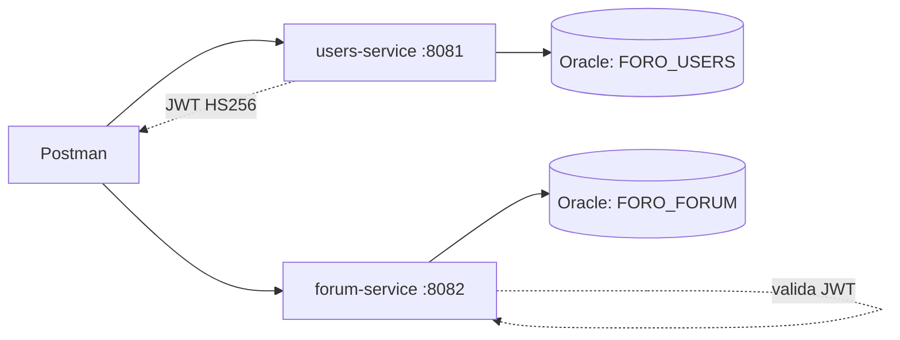

# Sistema de foros en linea

Backend academico para Full Stack III: **dos microservicios Spring Boot**, sin frontend y sin pagos. Java 17, Spring Boot 3.5.7, Maven, Spring Data JPA, Spring Security y Oracle JDBC. Organizacion por capas conforme a la guia de aprendizaje.

## Alcance

| Microservicio | Puerto | Responsabilidad |
| --- | --- | --- |
| users-service | 8081 | Registro, login y CRUD de usuarios; asignacion de roles |
| forum-service | 8082 | Categorias, busqueda, visualizacion, publicacion y comentarios |

`common` es una biblioteca compartida de seguridad y errores, **no un tercer microservicio**. No se implementa el tercer servicio de moderacion/baneo.

| Actor | Privilegios |
| --- | --- |
| Visitante | Registrar cuenta, iniciar sesion, leer categorias, temas y comentarios |
| USER | Lo anterior; consultar, actualizar y eliminar su cuenta; publicar, comentar y editar/eliminar contenido propio |
| ADMIN | Lo anterior; listar/gestionar cualquier usuario, asignar roles, administrar categorias y editar/eliminar cualquier tema o comentario |

El registro publico solo crea USER. ADMIN se crea con el perfil demo o por asignacion de otro ADMIN. Los DTO no admiten propiedades desconocidas: enviar `role` en registro o `authorId` al publicar devuelve 400.

## Arquitectura



Cada servicio usa su propio esquema, credenciales y tablas. No se realizan joins ni claves foraneas entre esquemas. `author_id` es el identificador de usuario obtenido del JWT; borrar una cuenta conserva sus publicaciones como historial.

```text
common/                  Seguridad JWT, CORS y manejo global de errores
users-service/
  src/main/java/cl/duoc/foro/users/
    controller/          Endpoints REST
    dto/                 Entradas validadas y respuestas sin contrasenas
    entity/              Entidades JPA
    repository/          Acceso a datos
    service/             Reglas de negocio
    config/              Datos de demostracion
forum-service/           Misma organizacion por capas
database/                DDL Oracle y consultas de comprobacion
postman/                 Coleccion importable con pruebas automaticas
.github/workflows/       Compilacion y pruebas en GitHub Actions
```

## 1. Compilar y probar

Desde la carpeta del proyecto, con JDK 17 y Maven 3.9 o superior:

```powershell
mvn verify
```

Genera un JAR ejecutable para cada servicio. Las pruebas usan **H2 en modo Oracle solo en test** y no requieren credenciales. Cubren JWT, CRUD, permisos, validaciones, filtros, asociaciones y datos iniciales. **H2 no demuestra compatibilidad completa con Oracle**: ejecutar ademas la coleccion Postman con los servicios conectados a Oracle.

## 2. Preparar Oracle

Se requiere Oracle 19c o superior (incluye Oracle Free y Autonomous Database). No usar una base productiva para esta evaluacion.

1. Crear las cuentas `FORO_USERS` y `FORO_FORUM`. En Oracle local, ejecutar como administrador `database/00-create-users-local.sql` con SQL*Plus, SQLcl o SQL Developer (Run Script/F5). Solicita claves sin incluirlas en el repositorio. Requiere el tablespace `USERS`.
2. En Autonomous Database, crear las mismas cuentas con permisos `CREATE SESSION`, `CREATE TABLE`, `CREATE SEQUENCE` y cuota en el tablespace `DATA`. El script de creacion local **no se aplica sin adaptar el tablespace**.
3. Conectar como `FORO_USERS` y ejecutar `database/01-users-schema.sql`.
4. Conectar como `FORO_FORUM` y ejecutar `database/02-forum-schema.sql`.

Los scripts crean tablas y secuencias; ejecutarlos **una sola vez sobre esquemas nuevos**. No contienen DROP, TRUNCATE ni borrados de datos. Hibernate usa `ddl-auto: validate`: comprueba el esquema, no lo crea ni lo elimina.

| Esquema | Tabla | Registros iniciales con demo |
| --- | --- | --- |
| FORO_USERS | APP_USERS | 3 |
| FORO_FORUM | FORUM_CATEGORIES | 5 |
| FORO_FORUM | FORUM_TOPICS | 3 |
| FORO_FORUM | FORUM_COMMENTS | 3 |

Relaciones internas: una categoria tiene muchos temas y un tema tiene muchos comentarios. Los roles son un enum/columna de APP_USERS, no una tabla adicional. Las cinco categorias son Tecnologia, Videojuegos, Ciencia, Deportes, Cine y series.

### Conexion local

En cada terminal configurar las variables que necesita su servicio. Los valores entre `<...>` son marcadores que debes reemplazar localmente, no claves reales:

```powershell
$env:JWT_SECRET = '<misma-clave-aleatoria-de-al-menos-32-bytes-en-ambos-servicios>'
$env:DEMO_PASSWORD = '<clave-demo-de-8-a-72-caracteres-ASCII-sin-espacios>'
```

Para usuarios:

```powershell
$env:USERS_DB_URL = 'jdbc:oracle:thin:@localhost:1521/FREEPDB1'
$env:USERS_DB_USERNAME = 'FORO_USERS'
$env:USERS_DB_PASSWORD = '<clave-de-FORO_USERS>'
```

Para foro:

```powershell
$env:FORUM_DB_URL = 'jdbc:oracle:thin:@localhost:1521/FREEPDB1'
$env:FORUM_DB_USERNAME = 'FORO_FORUM'
$env:FORUM_DB_PASSWORD = '<clave-de-FORO_FORUM>'
```

Para introducir una clave sin mostrarla ni escribirla en el historial de PowerShell 5.1:

```powershell
$env:USERS_DB_PASSWORD = [System.Net.NetworkCredential]::new('', (Read-Host 'Clave Oracle de usuarios' -AsSecureString)).Password
```

Aplicar el mismo patron a las otras claves. No publicar contrasenas, tokens ni Wallet en Git, capturas o videos.

### Conexion Oracle Cloud con Wallet

Descargar y descomprimir el Wallet **localmente**, por ejemplo en una carpeta `Wallet_Foro` dentro de la raiz del proyecto. Esta carpeta y sus certificados estan ignorados por Git. No modificar ni compartir sus secretos.

Reemplazar la URL local por el alias exacto que aparece en `tnsnames.ora` y una ruta absoluta con `/`. Ejemplo de formato, ajustando alias y ruta:

```powershell
$env:USERS_DB_URL = 'jdbc:oracle:thin:@miinstancia_high?TNS_ADMIN=C:/ruta/foro-microservicios/Wallet_Foro'
$env:FORUM_DB_URL = $env:USERS_DB_URL
```

Mantener distintos usuarios Oracle para cada servicio. Se incluyen `ojdbc11`, `oraclepki`, `osdt_core` y `osdt_cert` para Wallet. La accesibilidad de red, las credenciales, el alias TNS y la configuracion TLS del Wallet deben corresponder a tu instancia.

## 3. Arrancar y cargar datos

Con los esquemas nuevos ya creados y las variables configuradas, iniciar **primero usuarios** en una terminal:

```powershell
java -jar users-service/target/users-service-1.0.0-SNAPSHOT.jar --spring.profiles.active=demo
```

Esperar el mensaje de arranque y luego iniciar el foro en otra terminal:

```powershell
java -jar forum-service/target/forum-service-1.0.0-SNAPSHOT.jar --spring.profiles.active=demo
```

Las variables de entorno se configuran **en ambas terminales**; una terminal no hereda los cambios de otra. `JWT_SECRET` y `DEMO_PASSWORD` deben coincidir entre servicios. El foro obtiene los IDs reales de los autores iniciando sesion contra usuarios durante la carga demo. Si usuarios usa otro puerto, configurar `DEMO_USERS_URL` (por defecto `http://localhost:8081`). Los puertos se cambian con `USERS_PORT` y `FORUM_PORT`.

El perfil demo crea `admin@foro.test` (ADMIN), `ana@foro.test` y `luis@foro.test` (USER), todos con el valor local de `DEMO_PASSWORD`, almacenado con BCrypt. La carga de usuarios se omite si APP_USERS no esta vacia; la del foro se omite si alguna de sus tres tablas contiene registros. No rellena esquemas parcialmente poblados ni restablece claves al reiniciar. En ese caso revisar los datos existentes sin borrarlos automaticamente.

Para arranques posteriores sin carga inicial, omitir `--spring.profiles.active=demo`; no hace falta `DEMO_PASSWORD` ni mantener usuarios activo para consultar el foro.

Ejecutar las dos primeras consultas de `database/03-check-data.sql` conectado como FORO_USERS y las restantes como FORO_FORUM para evidenciar los registros. No ejecutar todo el archivo con una sola cuenta.

## 4. Validar con Postman

1. Importar `postman/Foro.postman_collection.json` en Postman.
2. Configurar localmente `demoPassword` con el valor usado al iniciar los servicios y revisar `usersUrl`/`forumUrl`.
3. Ejecutar **la coleccion completa en orden** con Collection Runner, una iteracion. No ejecutar solo la carpeta de eliminacion: depende de los IDs temporales creados antes.
4. Revisar las pruebas de estado HTTP, JSON, roles, autoria y cinco categorias. Los tokens e IDs se guardan automaticamente como variables de la coleccion.
5. La ultima carpeta elimina exclusivamente el usuario, categoria, tema y comentario temporales de esa ejecucion. Los tres usuarios, cinco categorias, tres temas y tres comentarios iniciales permanecen. Si una ejecucion se interrumpe puede dejar registros temporales; revisarlos por sus IDs antes de eliminarlos.

No exportar ni subir la coleccion despues de rellenar claves/tokens sin limpiar primero esos valores. Para el video mostrar las respuestas y permisos, ocultando secretos.

## Endpoints

Todos los cuerpos son JSON. Usar `Content-Type: application/json` al enviar cuerpos y `Authorization: Bearer <accessToken>` cuando corresponda. Fechas de creacion en UTC.

| Metodo | Ruta | Acceso |
| --- | --- | --- |
| POST | :8081/api/auth/register | Publico; displayName, email, password |
| POST | :8081/api/auth/login | Publico; email, password; devuelve accessToken |
| GET | :8081/api/users | ADMIN; paginado |
| GET | :8081/api/users/me | Autenticado |
| GET | :8081/api/users/{id} | Propietario o ADMIN |
| PUT | :8081/api/users/{id} | Propietario o ADMIN; displayName, email, password opcional |
| PUT | :8081/api/users/{id}/role | ADMIN; role: USER o ADMIN |
| DELETE | :8081/api/users/{id} | Propietario o ADMIN |
| GET | :8082/api/categories | Publico |
| GET | :8082/api/categories/{id} | Publico |
| POST | :8082/api/categories | ADMIN; name, description |
| PUT | :8082/api/categories/{id} | ADMIN; name, description |
| DELETE | :8082/api/categories/{id} | ADMIN; 409 si tiene temas |
| GET | :8082/api/topics | Publico; q (titulo), categoryId, page, size |
| GET | :8082/api/topics/{id} | Publico |
| POST | :8082/api/topics | Autenticado; title, content, categoryId |
| PUT | :8082/api/topics/{id} | Autor o ADMIN; title, content, categoryId |
| DELETE | :8082/api/topics/{id} | Autor o ADMIN; tambien elimina sus comentarios |
| GET | :8082/api/topics/{topicId}/comments | Publico; paginado |
| GET | :8082/api/topics/{topicId}/comments/{id} | Publico |
| POST | :8082/api/topics/{topicId}/comments | Autenticado; content |
| PUT | :8082/api/topics/{topicId}/comments/{id} | Autor o ADMIN; content |
| DELETE | :8082/api/topics/{topicId}/comments/{id} | Autor o ADMIN |

Paginacion: `page` desde 0, `size` de 1 a 100 (20 por defecto). `q` busca sin distinguir mayusculas y trata `%`/`_` como texto literal. `PUT` reemplaza los campos editables; no permite cambiar el autor.

Respuestas: 200 consulta/actualizacion/login; 201 creacion con Location; 204 eliminacion sin cuerpo; 400 validacion/JSON invalido; 401 falta de autenticacion/credenciales; 403 permisos; 404 recurso inexistente; 409 duplicados o asociaciones que impiden eliminar. Errores esperados en formato `application/problem+json`, con `errors` por campo para fallos de validacion.

## Seguridad y limites

Contrasenas BCrypt; ningun DTO expone el hash. JWT firmado HS256, emisor validado y duracion de 15 minutos. Ambos servicios deben compartir una clave aleatoria de al menos 32 bytes mediante el entorno, nunca el repositorio. CORS permite por defecto `http://localhost:3000`, configurable con `SECURITY_CORS_ORIGINS` (lista separada por comas). CSRF desactivado porque la API es stateless y usa Bearer, no cookies de sesion.

Los JWT son stateless: **eliminar una cuenta, cambiar su rol o su clave no revoca tokens ya emitidos**; conservan sus permisos hasta expirar (con la tolerancia de reloj del validador). No hay logout/revocacion inmediata, limitador de intentos ni recuperacion de clave. Antes de un uso productivo implementar revocacion/introspeccion, limitacion de intentos y HTTPS; valorar firma asimetrica para no compartir la clave privada. El perfil demo es exclusivamente academico.

## Git y colaboracion

El repositorio local se inicializa sin commits ni remoto. Revisar los archivos antes de publicar y configurar un repositorio remoto propio. Ejemplo de trabajo posterior, que debes ejecutar con tu cuenta:

```powershell
git status
git add .
git commit -m "Implementar usuarios y foro con Oracle"
git remote add origin https://github.com/GinaRaffaela/foro-microservicios.git
git push -u origin HEAD
```

Coordinar tareas mediante issues, trabajar en ramas por funcionalidad, abrir pull requests y revisar los cambios con un companero antes de integrar. GitHub Actions ejecuta `mvn verify` en push y pull request. La creacion del remoto, los commits del alumno y la evidencia de colaboracion no se simulan: deben realizarse realmente. El `.gitignore` excluye compilados, Wallets y configuraciones locales, pero siempre revisar `git diff --cached` antes del commit.

## Evidencias para la evaluacion

1. Mostrar los dos servicios arrancados con Oracle, sus paquetes y los esquemas/tablas.
2. Mostrar los conteos de las cuatro tablas y las cinco categorias.
3. En Postman demostrar login, registro, GET/POST/PUT/DELETE de ambos servicios y busqueda por titulo/categoria.
4. Contrastar USER y ADMIN: lista de usuarios, gestion de categorias y rechazo 403 de acciones no autorizadas.
5. Mostrar las pruebas automaticas, el historial Git, los pull requests reales y el resultado del Runner sin exponer claves.
